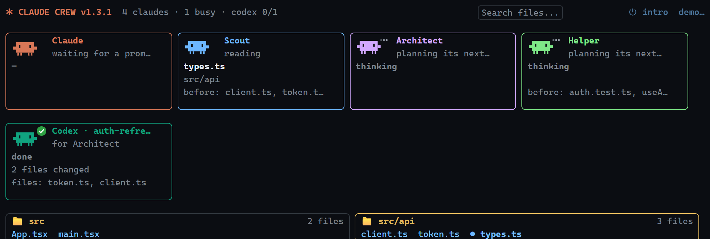
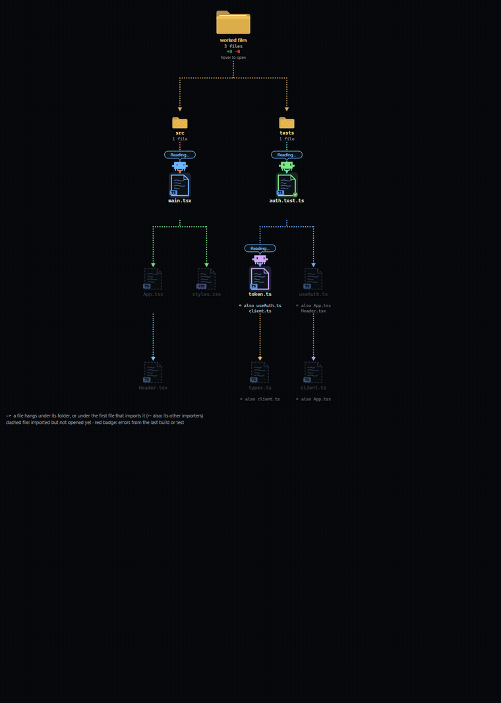

# Claude Crew + Codex Bridge

By [D3K1D](https://github.com/D3K1D), made with [Claude](https://claude.com/claude-code).

Two mods for [Claude Code](https://claude.com/claude-code) (the desktop app's Code tab and the terminal):

- **Claude Crew** (`crew-map`): a live view of Claude and its helper Claudes at work. See what each one is on right now, which folders and files they've touched and changed, what it costs, how full each one's context is, when one is waiting on you, when tests are running, and which files a build broke.
- **Codex Bridge** (`codex-bridge`): lets Claude hand tasks to OpenAI Codex as a subagent, using your own ChatGPT/Codex subscription. Codex keeps memory per project, and named threads carry on where they left off.

They work on their own and better together: with both installed, a running Codex gets its own desk and window in the crew view.



## Claude Crew (`/crew`)

- **Desks and folder cards.** Every Claude at work has a desk with a small animated Claude, what it's on now and what it touched before. Below, every folder the crew touched is a card of file chips: green with line counts when edited, red when a build failed on them, with a coloured dot while a Claude is on them. Click a chip to open the file. The older tree map is one click away.
- **A window per Claude.** Each window shows its goal, a progress bar counted from Claude's own task list, tokens with a dollar estimate, how full its context is (and how often it was compacted), what it's doing and its last actions. Finished helpers fold into one line.
- **What it's waiting on.** When a Claude needs a permission, an answer or a plan approval, its desk and window turn amber, move to the front, and say what it needs. The main Claude also says when it's waiting on its helpers or on a command, and when it's your turn.
- **Tests and commands.** A running line shows each long command and test run in plain words, with a timer. Test results (passed/failed counts) appear in the window, the log and a pop-up.
- **Problems.** When a build or test fails, the files it names turn red with an error count. A Problems list shows each error, and clicking one opens the file at that line. Supported output: rustc/cargo, tsc, C#/MSBuild, gcc/clang, Go, Python tracebacks, pytest and jest/vitest.
- **Stuck warning.** You get a heads-up when a Claude runs the same failing command three times, has its last five tool calls fail, or keeps rewriting one file.
- **Budget.** Set a dollar budget in the pane. You'll get a pop-up at 50%, 80% and 100%, and a spend-by-Claude bar shows who's using what.
- **Replay.** Step back through the session one tool call at a time, or let it play.
- **Task summary.** When a task ends, a card lists the files changed, tests, cost and time. **Copy as Markdown** turns it into something you can paste into a PR.
- **Tree map** (optional): files as icons hung under their folders and importers, with stations for work that isn't a file (the terminal, research, the browser, this PC or a remote one, documents, other MCP apps).
- Click any folder to open it in your file manager, and any file to open it: pictures, video, audio and documents in your system's app for them (Photos for a .png on Windows), code in VS Code or Cursor (as a diff against your last commit). Programs are shown in their folder, never run.



## Codex Bridge (`/codex`)

- Ask in plain words: *"have Codex review the renderer"*, or *"give Codex a thread called chunk-loader and make chunk loading async"*. Claude writes Codex a self-contained brief, picks the model and effort, and reads back Codex's answer, the files it changed and the commands it ran.
- **Read-only** by default; **write** mode edits files inside the project only.
- **Memory**: each project gets a `.codex-bridge/` folder (kept out of git) with Codex's notes and a log per thread.
- **Threads**: rename, start fresh, archive or delete them from the pane (or ask Claude to).
- **Usage**: your plan's 5-hour and weekly limits as bars, with reset times. Claude sees them too, so it can go easy when you're close.
- A live pane of each run, with a stop button and clickable changed files.

## Install

You need **Claude Code 2.1.275 or later**. Codex Bridge also needs the **Codex CLI** signed in to your account: the [Codex desktop app](https://openai.com/codex) includes it, or install it with `npm i -g @openai/codex` and run `codex login`.

### Option 1: the plugin command (recommended)

In a terminal, start `claude` and type:

```
/plugin install crew-map --marketplace D3K1D/claude-crew-mods
/plugin install codex-bridge --marketplace D3K1D/claude-crew-mods
```

Answer `y` to add the marketplace, then choose the **user** scope so the mods load in every project. Mods installed this way also load in the desktop app's Code tab. Quit the desktop app completely and reopen it, then start a new chat.

### Option 2: the install script

Clone this repository, then run:

```powershell
powershell -ExecutionPolicy Bypass -File scripts\install.ps1
```

on Windows, or

```bash
sh scripts/install.sh
```

on macOS and Linux.

The script copies both mods to `~/.claude/mods` and adds them to `~/.claude/settings.json`, backing that file up first. Pass a mod name (`crew-map` or `codex-bridge`) to install just that one. Restart Claude Code and open a new chat afterwards.

### Option 3: by hand

Copy the `crew-map` and `codex-bridge` folders somewhere permanent, and add this to `~/.claude/settings.json`:

```json
{
  "env": {
    "CLAUDE_CODE_PLUGIN_DIRS": "C:\\path\\to\\crew-map;C:\\path\\to\\codex-bridge",
    "CLAUDE_CODE_ENABLE_FUNCTION_HOOKS": "1"
  }
}
```

Use `;` between folders on Windows and `:` on macOS/Linux.

## Using them

- `/crew` opens the crew view. Press **▶ demo** to watch three pretend Claudes and a pretend Codex work on a pretend project for half a minute.
- `/codex` opens the Codex pane.
- Then just work as usual. To bring Codex in, ask for it: *"get Codex's opinion on this"*, *"have Codex write the tests on a thread called tests"*.

## Troubleshooting

- **`/crew` or `/codex` doesn't appear.** Quit the desktop app completely (not just the window), reopen it, and start a **new** chat; open chats keep the mods they started with. If that doesn't help, make sure `CLAUDE_CODE_ENABLE_FUNCTION_HOOKS` is `"1"` in the `env` block of `~/.claude/settings.json`.
- **See why a mod didn't load:** in a terminal, run `claude plugin validate <mod folder>`, or start `claude --debug` and look for lines starting with `crew-map:` or `codex-bridge:`.
- **"Codex CLI was not found".** Install the Codex app or `npm i -g @openai/codex`, then run `codex login`. On macOS and Linux, Codex Bridge looks in Codex.app, Homebrew, `/usr/local/bin`, `~/.local/bin` and your PATH.
- **Codex can't write files in write mode.** On Windows, Codex's sandbox refuses folders under `AppData`, including a chat's own scratch folder. Use a normal project folder.
- **No usage bars.** Codex writes its limits into its session logs after each run, so the bars appear after your first Codex run.
- **No "waiting on you" or compaction in Claude Crew.** Where an organization manages Claude Code, the permission and compaction events reach only plugins the organization lists in its managed settings, so a mod you install yourself doesn't see them. Everything else works.

## Platforms

Built and used daily on **Windows**. The macOS and Linux code paths (opening files, finding Codex, temp folders, the install script) are covered by the test suite but haven't been tried on real machines yet. Issues and fixes are welcome.

## Privacy

Everything stays on your machine. The mods read Claude Code's own events and your project files. Codex Bridge runs the Codex CLI you installed and reads Codex's local session logs for the usage numbers. Neither mod sends anything anywhere itself. Costs are estimates at Anthropic's API list prices (subscriptions aren't billed per token), meant as a yardstick.

## Development

```bash
npm install
npm test
claude plugin validate .
```

`npm test` builds both mods for Node and runs the suites in `tests/` (about 720 checks, with no Claude Code needed), then, when Claude Code is installed, draws both panes through its own engine with `claude plugin test`. `claude plugin validate .` checks the marketplace and both manifests.

To try a change live, start `claude --plugin-dir ./crew-map`, or put the folder in `CLAUDE_CODE_PLUGIN_DIRS`. Edits reload when Claude's turn ends.

Each mod is one hooks module (`<mod>/hooks/register.tsx`) plus a type contract (`<mod>/types/index.d.ts`) for the state it keeps. Claude Code writes its API types into `<mod>/.claude-plugin/types/` when it loads a mod; that folder is git-ignored.

## Credits

Created by [D3K1D](https://github.com/D3K1D).

These mods were built with the help of Claude, Anthropic's AI model, working in [Claude Code](https://claude.com/claude-code). Claude wrote much of the code, the tests and the documentation under D3K1D's direction, and D3K1D designed, reviewed and tested them in daily use. Commits made with Claude's help carry a `Co-Authored-By: Claude` line.

## License

[MIT](LICENSE) © 2026 D3K1D
