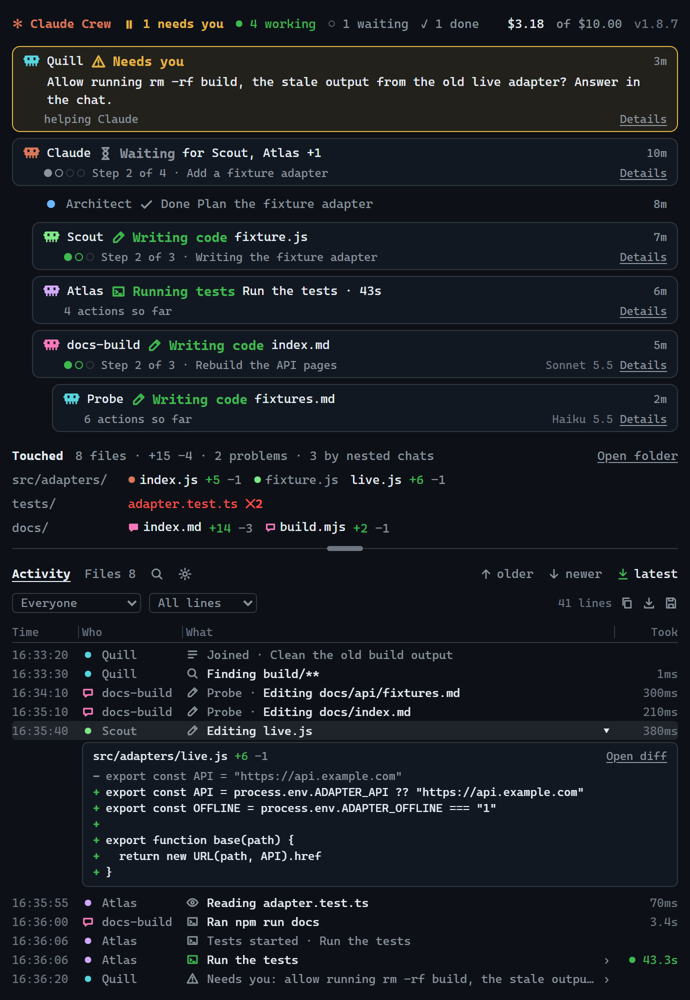
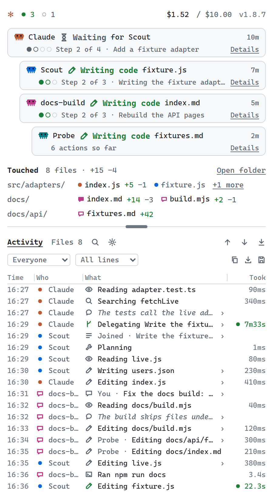

# Claude Crew + Codex Bridge

<p align="center">
  <a href="https://github.com/D3K1D/claude-crew-mods/releases"></a>
  <a href="LICENSE"></a>
  <a href="https://github.com/D3K1D/claude-crew-mods/actions/workflows/test.yml"></a>
  <a href="https://nodejs.org"></a>
  <a href="https://claude.com/claude-code"></a>
</p>

<p align="center">
  <a href="#quick-start">Quick start</a> ·
  <a href="#install">Install</a> ·
  <a href="#privacy-and-data">Privacy</a> ·
  <a href="#troubleshooting">Troubleshooting</a> ·
  <a href="crew-map/README.md">Claude Crew</a> ·
  <a href="codex-bridge/README.md">Codex Bridge</a>
</p>

Two mods for [Claude Code](https://claude.com/claude-code), made for the Code tab of the Claude desktop app:

- **[Claude Crew](crew-map/README.md)** (`crew-map`) is a live website beside the chat. It shows what Claude, its helpers and the chats it started are doing, what needs you, the files they touched and what it cost. Its log opens every action to its diff, output or error.
- **[Codex Bridge](codex-bridge/README.md)** (`codex-bridge`) lets Claude hand tasks to OpenAI Codex as a subagent. It runs on your own ChatGPT/Codex subscription and keeps memory per project and named threads.

Each works on its own. With both installed, a running Codex gets its own row in Claude Crew.



## Quick start

```
claude plugin install crew-map --marketplace D3K1D/claude-crew-mods
```

Then quit and reopen the Claude desktop app, start a new chat in the Code tab, and type `/crew`. The chat's crew opens in the browser pane beside it.

## Commands

| Command | What it does |
| --- | --- |
| `/crew` | Opens this chat's Claude Crew website in the browser pane. |
| `/crew-review` | Starts a nested chat that summarises recent changes from Claude Crew's logs and git ([details](crew-map/README.md#reviewing-the-work-crew-review)). |
| `/codex` | Opens the Codex pane. To use Codex, ask Claude: *"have Codex review the renderer"*. |

## Screenshots

The log, with a failed test run opened to its output and an edit opened to its diff:


The light theme at the browser pane's narrow width:



## Install

### Requirements

- **Claude Code 2.1.275 or later** (`claude --version`). Claude Crew is made for the desktop app's Code tab. In a terminal, it shows the same view as text.
- **Node.js 18 or later** on your PATH, for Claude Crew's website (`node --version`). Neither the Claude app nor Claude Code includes it. Without Node, `/crew` shows the view as text in the mod's own pane.
- **Codex Bridge only:** the Codex CLI, signed in. The [Codex desktop app](https://openai.com/codex) includes it, or run `npm i -g @openai/codex` and then `codex login`.

### With the plugin command (recommended)

```
claude plugin install crew-map --marketplace D3K1D/claude-crew-mods
claude plugin install codex-bridge --marketplace D3K1D/claude-crew-mods
```

The first command adds the `crew-mods` marketplace. Both install for your user, so the mods load in every project. Inside Claude Code, `/plugin install crew-map --marketplace D3K1D/claude-crew-mods` does the same. Afterwards, quit the desktop app completely, reopen it and start a **new** chat.

If `/crew` doesn't appear in a new chat, add this to the `env` block of `~/.claude/settings.json` and restart the app:

```json
"CLAUDE_CODE_ENABLE_FUNCTION_HOOKS": "1"
```

### With the install script

Clone this repository and run `scripts\install.ps1` (Windows) or `scripts/install.sh` (macOS, Linux):

```powershell
powershell -ExecutionPolicy Bypass -File scripts\install.ps1
```

```bash
sh scripts/install.sh
```

The script copies both mods to `~/.claude/mods` and adds them to `CLAUDE_CODE_PLUGIN_DIRS` in `~/.claude/settings.json`. It backs that file up first and sets `CLAUDE_CODE_ENABLE_FUNCTION_HOOKS` for you. Pass `crew-map` or `codex-bridge` to install only one.

### Updating and uninstalling

| | Plugin command | Install script |
| --- | --- | --- |
| Update | `claude plugin marketplace update crew-mods`, then `claude plugin update crew-map` (and `codex-bridge`) | `git pull`, then run the script again |
| Uninstall | `claude plugin uninstall crew-map` (and `codex-bridge`); `claude plugin marketplace remove crew-mods` if nothing else uses it | Remove the folders from `CLAUDE_CODE_PLUGIN_DIRS`, then delete `~/.claude/mods/crew-map` and `~/.claude/mods/codex-bridge` |

Restart the app after either. Claude Crew keeps its own files in `~/.claude/crew-map`, which you can delete. Saved logs stay in each project's `.claude/crew-logs`.

## How it works

- Claude Crew listens to Claude Code's events (tool calls and their results, replies, helpers starting, turns, usage) and keeps each chat's crew.
- `/crew` starts a small Node server for that chat on `127.0.0.1`, about 50 MB, using well under 1% of a CPU core. A chat that never opens `/crew` runs no extra process. The mod sends the server the view as data. The page draws the view and sends each press back.
- Each chat writes a small file about itself, plus its log, to `~/.claude/crew-map`. That is how the chat above it, and other chats in the same project, show its card, steps and lines.
- Codex Bridge runs the Codex CLI you installed and publishes its runs, which Claude Crew shows as rows.

## Privacy and data

- **Everything stays on your computer.** Neither mod sends anything anywhere itself. Codex Bridge runs your own Codex CLI.
- **The website** listens on `127.0.0.1` only, with a random token in its address. It refuses other hosts and other sites, and the mod's own requests carry a second key that the page never sees.
- **Claude Crew keeps** each chat's log in `~/.claude/crew-map`. That is the newest 5,000 lines, and it includes the last lines of command output, so a command that printed a secret leaves it there. Files that haven't been written for 30 days are deleted.
- **Saved logs** go to the project's `.claude/crew-logs` only when you press Save, or after each task if you turn that on.
- **Costs** are estimates at Anthropic's API list prices, a yardstick only: Pro and Max plans aren't billed per token. Saving a log asks Claude Haiku for a summary, about $0.01 for a typical chat. `/crew` runs one ordinary turn of the chat's model to open the pane.

## Troubleshooting

- **`/crew` or `/codex` doesn't appear.** Quit the desktop app completely (not just the window), reopen it, and start a **new** chat: open chats keep the mods they started with. Then check `CLAUDE_CODE_ENABLE_FUNCTION_HOOKS` (see above).
- **`/crew` opens a text pane instead of the website.** Node.js wasn't found. Install Node 18 or later and restart the app.
- **The website says the crew has stopped.** The chat ended or the mod reloaded. Type `/crew` again.
- **Nested chats say "as of 13:09".** In this chat's permission mode (auto mode, for example), reading the app's chat list needs an approval. Their cards update whenever Claude looks at the chats itself.
- **No "waiting on you" or compaction in Claude Crew.** Where an organization manages Claude Code, those events reach only the plugins listed in its managed settings.
- **"Codex CLI was not found".** Install the Codex app, or run `npm i -g @openai/codex`, then run `codex login`.
- **Codex can't write in write mode.** On Windows, Codex's sandbox refuses folders under `AppData`. Use a normal project folder.
- **A mod doesn't load.** Run `claude plugin validate <mod folder>`, or start `claude --debug` and look for lines starting with `crew-map:` or `codex-bridge:`.

## Platforms

Both mods are built and used daily on **Windows**. The macOS and Linux paths (opening files, finding Codex, the install script) are covered by tests but haven't been tried on real machines yet. Issues and fixes are welcome.

## Development

```bash
npm install
npm test
claude plugin validate .
```

`npm test` builds both mods for Node and runs the suites in `tests/`. When Claude Code is installed, it also draws both panes through Claude Code's own engine with `claude plugin test`. `claude plugin validate .` checks the marketplace and both manifests.

Each mod is one hooks module (`<mod>/hooks/register.tsx`) plus a type contract (`<mod>/types/index.d.ts`). Claude Crew's website is in `crew-map/web/`. To try a change live, start `claude --plugin-dir ./crew-map`: edits reload when Claude's turn ends.

## Credits

Created by [D3K1D](https://github.com/D3K1D) and built with Claude in [Claude Code](https://claude.com/claude-code). Claude wrote much of the code, the tests and the documentation under D3K1D's direction. D3K1D designed, reviewed and tested the mods in daily use. Commits made with Claude's help carry a `Co-Authored-By: Claude` line.

## License

[MIT](LICENSE) © 2026 D3K1D
