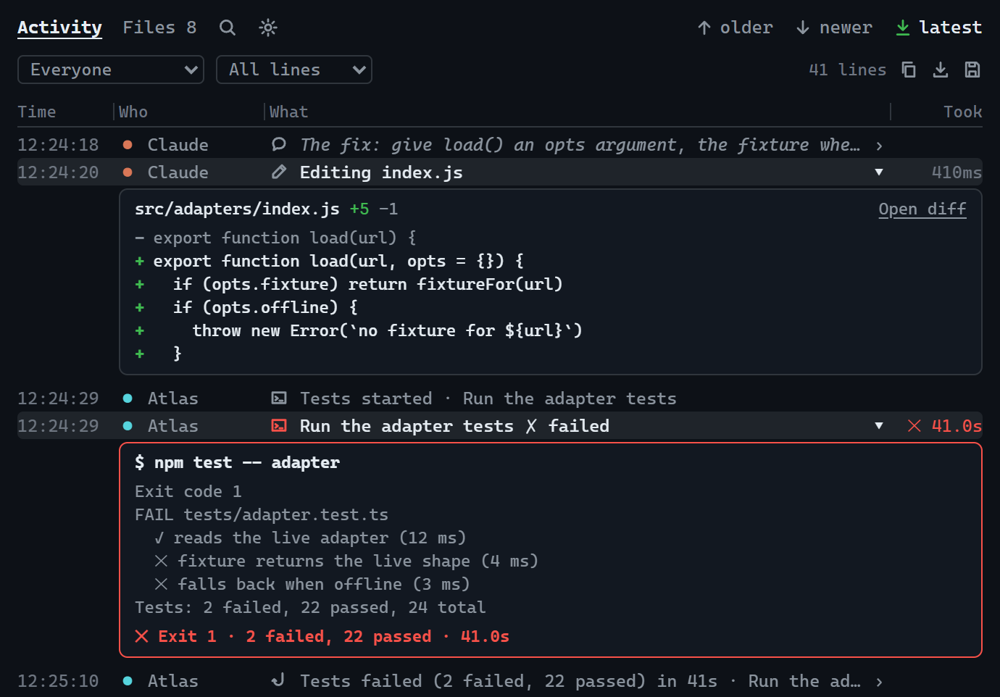

# Claude Crew + Codex Bridge

<p align="center">
  <a href="https://github.com/D3K1D/claude-crew-mods/releases"></a>
  <a href="LICENSE"></a>
  <a href="https://github.com/D3K1D/claude-crew-mods/actions/workflows/test.yml"></a>
  <a href="https://nodejs.org"></a>
  <a href="https://claude.com/claude-code"></a>
</p>

<p align="center">
  <a href="#quick-start">Quick start</a> ·
  <a href="#screenshots">Screenshots</a> ·
  <a href="#how-it-works">How it works</a> ·
  <a href="#install">Install</a> ·
  <a href="#settings">Settings</a> ·
  <a href="#privacy-and-data">Privacy</a>
</p>

By [D3K1D](https://github.com/D3K1D), made with [Claude](https://claude.com/claude-code).

Two mods for [Claude Code](https://claude.com/claude-code), made for the Claude desktop app's Code tab:

- **Claude Crew** (`crew-map`): a live website beside the chat that shows what Claude, its helper Claudes and the chats it started are doing, what needs you, what they touched and what it cost, with a log where every action opens to its diff, output or error.
- **Codex Bridge** (`codex-bridge`): lets Claude hand tasks to OpenAI Codex as a subagent, using your own ChatGPT/Codex subscription, with memory per project and named threads.

They work on their own and better together: with both installed, a running Codex gets its own row in Claude Crew.


## Quick start

1. In a terminal, start `claude` and type `/plugin install crew-map --marketplace D3K1D/claude-crew-mods` (choose the **user** scope).
2. Quit and reopen the Claude desktop app, and start a new chat in the Code tab.
3. Type `/crew`: the chat's crew opens in the browser pane beside it.

Needs Claude Code 2.1.275+ and Node.js 18+; the [Install](#install) section has the details, the script route, updating and uninstalling.

## Claude Crew (`/crew`)

Type `/crew` in a chat and Claude opens that chat's crew in the browser pane beside it. The page is served by the mod on your own computer and updates live.

- **Who is doing what.** A card per Claude: what it is doing in plain words ("Running tests · 42s"), a pip per step ("Step 2 of 4 · Write the pages"), how full its context is, its model and its time. Helpers sit under the Claude that started them, and a Claude's Details list them. Each Claude keeps a colour of its own for the whole chat; the state words say green working, indigo waiting on its helpers, amber needs you.
- **What needs you.** A Claude waiting for a permission, an answer or a plan approval is pinned on top in amber, with its whole request.
- **Nested chats.** Chats that Claude started from this one (and theirs) show like helpers: their card, their own helpers, their steps, cost, files and log lines, marked with a chat bubble in their colour.
- **This project.** The other chats working in the same project (the same repository or folder), under their own heading: a card for each one at work or needing you, a short line for the idle ones. Their log lines join only when you pick them in the log's filter.
- **What the work touched.** The folders worked in lately, their files as buttons: lines added and removed, errors in red. Click a file to open it (an edited one as a diff).
- **The log.** Every action, thought and message in time order, with how long each took. Open an action to see what happened: an edit's changed lines, a command's last output and exit, a failed call's error. Filter it by Claude or chat, or to edits, commands or failures; size its columns; load older lines back to the start of the chat.
- **Cost.** The chat's cost (nested chats included) against a budget if you set one.
- **Saving.** Copy the log as Markdown, download it, or save it into the project with a short summary written by Claude Haiku, so later chats can read what was done and why.

More about each part, the settings and the files it keeps: [crew-map/README.md](crew-map/README.md).

## Codex Bridge (`/codex`)

- Ask in plain words: *"have Codex review the renderer"*, or *"give Codex a thread called chunk-loader and make chunk loading async"*. Claude writes Codex a self-contained brief, picks the model and effort, and reads back Codex's answer, the files it changed and the commands it ran.
- **Read-only** by default; **write** mode edits files inside the project only.
- **Memory**: each project gets a `.codex-bridge/` folder (kept out of git) with Codex's notes and a log per thread.
- **Threads**: rename, start fresh, archive or delete them from the pane (or ask Claude to).
- **Usage**: your plan's 5-hour and weekly limits as bars, with reset times.

More: [codex-bridge/README.md](codex-bridge/README.md).

## Screenshots

The log, with a failed test run opened to its output and an edit opened to its diff:



The light theme at the browser pane's narrow width, with a nested chat's card, files and log lines:


## Install

### What you need

- The **Claude desktop app** with its **Code** tab (Claude Crew's website opens in the app's browser pane), or Claude Code in a terminal (there you get the same view as text).
- **Claude Code 2.1.275 or later** (`claude --version`).
- **Node.js 18 or later** on your PATH for Claude Crew's website (`node --version`; get it from [nodejs.org](https://nodejs.org)). Neither the Claude app nor Claude Code includes it. Without Node, `/crew` opens the mod's own pane with the same view as text instead.
- For Codex Bridge only: the **Codex CLI**, signed in. The [Codex desktop app](https://openai.com/codex) includes it, or run `npm i -g @openai/codex` and then `codex login`.

### Option 1: the plugin command (recommended)

In a terminal, start `claude` and type:

```
/plugin install crew-map --marketplace D3K1D/claude-crew-mods
/plugin install codex-bridge --marketplace D3K1D/claude-crew-mods
```

Answer `y` to add the marketplace, then choose the **user** scope so the mods load in every project (the desktop app's Code tab uses them too). Then quit the desktop app completely, reopen it, and start a **new** chat.

If `/crew` doesn't appear in a new chat, add this to the `env` block of `~/.claude/settings.json` and restart the app:

```json
"CLAUDE_CODE_ENABLE_FUNCTION_HOOKS": "1"
```

### Option 2: the install script

Clone this repository, then run, on Windows:

```powershell
powershell -ExecutionPolicy Bypass -File scripts\install.ps1
```

or on macOS and Linux:

```bash
sh scripts/install.sh
```

The script copies both mods to `~/.claude/mods` and points Claude Code at them in `~/.claude/settings.json` (backing that file up first, and setting `CLAUDE_CODE_ENABLE_FUNCTION_HOOKS` for you). Pass `crew-map` or `codex-bridge` to install just one. Restart the app and start a new chat.

### Updating

- **Plugin command:** in a terminal, `claude plugin marketplace update crew-mods`, then `claude plugin update crew-map` (and `codex-bridge`). Restart the app.
- **Install script:** `git pull` in your clone and run the script again.

### Uninstalling

- **Plugin command:** `claude plugin uninstall crew-map` (and `codex-bridge`), then `claude plugin marketplace remove crew-mods` if you added it only for these.
- **Install script:** remove the mod folders from `CLAUDE_CODE_PLUGIN_DIRS` in `~/.claude/settings.json` (and `CLAUDE_CODE_ENABLE_FUNCTION_HOOKS` if nothing else needs it), then delete `~/.claude/mods/crew-map` and `~/.claude/mods/codex-bridge`.
- Claude Crew's own files are in `~/.claude/crew-map` (you can delete the folder); saved logs stay in each project's `.claude/crew-logs`.

## Using them

- `/crew` opens the chat's crew. With nothing going on yet, **▶ Try a pretend session** shows a pretend crew at work for half a minute.
- `/crew-review` starts a chat called **Crew Review** that reads Claude Crew's logs and the git history and summarises what changed, then asks what to do with the summary. See [Reviewing the work](crew-map/README.md#reviewing-the-work-crew-review).
- `/codex` opens the Codex pane.
- Then work as usual. To bring Codex in, ask for it: *"get Codex's opinion on this"*, *"have Codex write the tests on a thread called tests"*.

## Settings

Claude Crew's **⚙** tab (kept between chats):

- **Theme:** auto (follows the app), light or dark.
- **Budget:** a dollar limit, with a heads-up at 50%, 80% and 100%.
- **Open files in:** VS Code, Cursor or your system's default app.
- **Outside files:** show or hide files outside the project.
- **Save log:** when you press Save, or after each task.
- **Test toasts:** a pop-up when a test run ends (off by default).
- **Demo:** a pretend session to try it.

## How it works

- The mod listens to Claude Code's events (tool calls and their results, replies, helpers starting, turns, usage) and keeps the crew's state.
- `/crew` starts a small Node server for that chat on `127.0.0.1`. The mod sends it the view as data; the page draws it and sends each press back.
- Each chat writes a small file about itself and its log to `~/.claude/crew-map`, so the chat above it (and others in the same project) can show its card, steps and lines.
- Codex Bridge runs the Codex CLI you installed and publishes its runs, which Claude Crew shows as a row.

## Privacy and data

- **Everything stays on your computer.** Neither mod sends anything anywhere itself. Codex Bridge runs the Codex CLI you installed.
- **The website** listens on `127.0.0.1` only, with a random token in its address; it refuses other hosts and other sites, and the mod's own requests carry a second key the page never sees.
- **What Claude Crew keeps** in `~/.claude/crew-map`: each chat's log (its newest 5,000 lines, including the last lines of command output, so output that printed a secret is kept there too), the files it touched, and a small file per chat for the chat above it. Files nothing has written for 30 days are deleted (checked once a day).
- **Saved logs** go into the project's `.claude/crew-logs` only when you press Save (or set Save log to "after each task").

## Costs

- Costs shown are estimates at Anthropic's API list prices (Pro and Max plans aren't billed per token), meant as a yardstick.
- Saving a log asks **Claude Haiku** for a summary: about $0.01 for a typical chat, at most about $0.05. Later saves send only what's new, and a save with nothing new asks nothing.
- `/crew` itself runs one ordinary turn of the chat's model to open the pane.

## Performance

Light: a chat that never opens `/crew` runs no extra process; one with its website open runs a small Node server (about 50 MB) and uses well under 1% of one CPU core while Claude works.

## Troubleshooting

- **`/crew` or `/codex` doesn't appear.** Quit the desktop app completely (not just the window), reopen it, and start a **new** chat: open chats keep the mods they started with. Check `CLAUDE_CODE_ENABLE_FUNCTION_HOOKS` (above).
- **`/crew` opens a text pane instead of the website.** Node.js isn't found: install Node 18+ and restart the app.
- **The website says the crew has stopped.** The chat ended or the mod reloaded: type `/crew` again.
- **Nested chats say "as of 13:09".** Reading the app's chat list needs an approval in this chat's permission mode (auto mode, for example), so their cards update when Claude itself looks at the chats.
- **See why a mod didn't load:** run `claude plugin validate <mod folder>`, or start `claude --debug` and look for lines starting with `crew-map:` or `codex-bridge:`.
- **"Codex CLI was not found".** Install the Codex app or `npm i -g @openai/codex`, then run `codex login`.
- **Codex can't write files in write mode.** On Windows, Codex's sandbox refuses folders under `AppData`. Use a normal project folder.
- **No "waiting on you" or compaction in Claude Crew.** Where an organization manages Claude Code, those events reach only plugins the organization lists in its managed settings.

## Platforms

Built and used daily on **Windows**. The macOS and Linux code paths (opening files, finding Codex, the install script) are covered by the tests but haven't been tried on real machines yet. Issues and fixes are welcome.

## Development

```bash
npm install
npm test
claude plugin validate .
```

`npm test` builds both mods for Node and runs the suites in `tests/`, then, when Claude Code is installed, draws both panes through its own engine with `claude plugin test`. `claude plugin validate .` checks the marketplace and both manifests.

To try a change live, start `claude --plugin-dir ./crew-map`, or put the folder in `CLAUDE_CODE_PLUGIN_DIRS`. Edits reload when Claude's turn ends.

Each mod is one hooks module (`<mod>/hooks/register.tsx`) plus a type contract (`<mod>/types/index.d.ts`); Claude Crew's website is in `crew-map/web/`.

## Credits

Created by [D3K1D](https://github.com/D3K1D).

These mods were built with the help of Claude, Anthropic's AI model, working in [Claude Code](https://claude.com/claude-code). Claude wrote much of the code, the tests and the documentation under D3K1D's direction, and D3K1D designed, reviewed and tested them in daily use. Commits made with Claude's help carry a `Co-Authored-By: Claude` line.

## License

[MIT](LICENSE) © 2026 D3K1D
