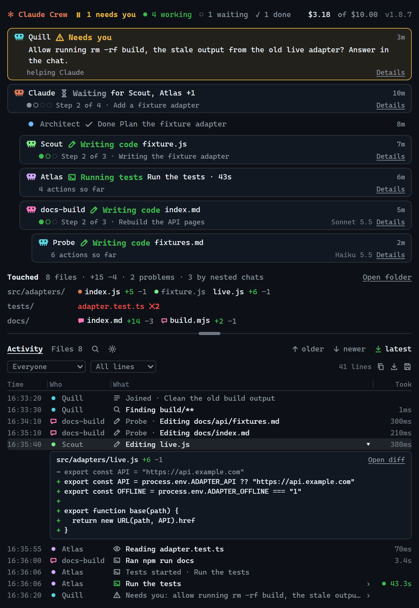
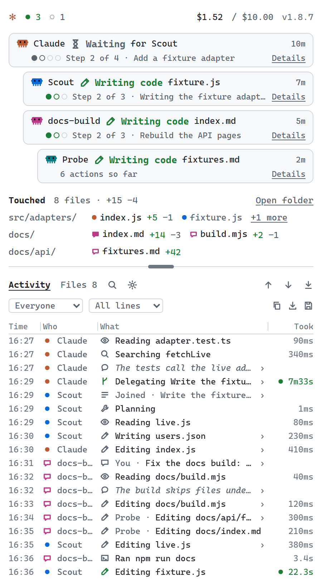
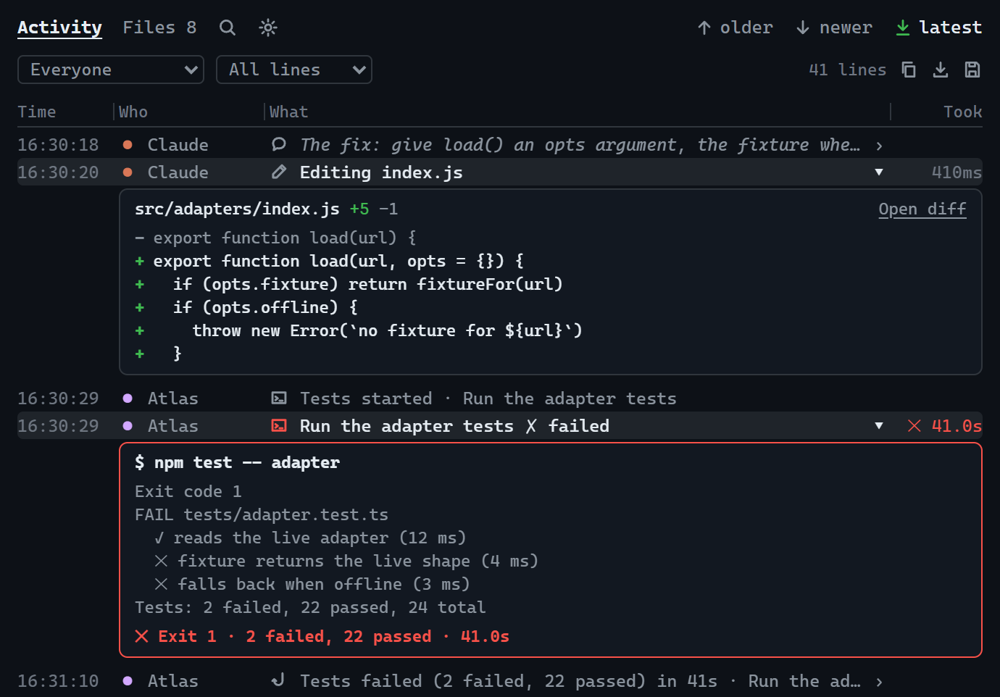

# Claude Crew (plugin `crew-map`)

A live website of what Claude, its helper Claudes and the chats it started are doing, for when you give Claude Code a task and want to *see* the work instead of scrolling through a transcript.

```
/plugin install crew-map --marketplace D3K1D/claude-crew-mods
```

It needs Node.js 18 or later. The repository's [README](../README.md) has the full install steps, updating, uninstalling and troubleshooting.



## Opening it

Type `/crew` in a chat. The chat's website starts (a small Node server on your computer; a chat that never opens it runs none) and Claude opens it in the browser pane beside the chat. If it doesn't open, click the address `/crew` shows. When you reopen Claude and go back to the chat, the website comes back at the same address, so the browser pane finds it again.

Without Node, `/crew` opens the mod's own pane instead, with the same view as text. In a terminal, the pane is the view.

## What it shows

**The header.** Counts by state (**⏸ 1 needs you**, **● 3 working**, **◌ 1 waiting**, **✓ 2 done**) and what the chat has cost, nested chats included (hover for each chat's share), against a budget if you set one.

**The Claudes.** A card per Claude. Line one: its name, what it is doing in plain words ("Writing code · fixture.js", "Running tests · 42s", "Waiting · for Scout") and its time. Line two: a pip per step and "Step 2 of 4 · Wire the fixture" (or "4 actions so far"), its model, and **Details**. Colour means state only: green working, grey waiting or idle, amber needs you, dim done. Helpers sit indented under the Claude that started them. One that needs you is pinned on top in amber with its whole request. One that looks stuck says why, in amber (the same command failing three times, and the like).

**Nested chats.** A chat Claude started from this one (and the chats that one started) shows like a helper: its card under its short name and colour, its own helpers under it, its steps, model and cost. One that needs you is pinned on top too, with "answer in that chat" (Claude Crew can't answer another chat's prompt). Its files join Touched and Files, and its lines join the log, marked with a chat bubble in its colour.

 Where reading the app's chat list needs an approval (auto mode, for example), nested cards update when Claude itself looks at the chats, and say **as of 13:09** until then.

**When it's done.** With nobody working, the last task's card shows how long it took, what changed, the tests, the cost and who worked on it.

**Touched.** The three folders worked in lately, their files as buttons: lines added and removed, a red **✕2** when a build or test named errors in it, a dot on the file a Claude is editing now, and a bubble on a file a nested chat touched. Click a file to open it: an edited file as a diff against your last commit, a broken one at its first error, pictures and documents in their own app, code in the editor you pick (VS Code, Cursor, or your system's default). Programs are shown in their folder, never run.

**The log** (the Activity tab). Every action, thought and message in time order, with who did it and how long each action took. Click a line to open it: a thought shows all Claude said; an action shows what came of it (an edit's lines taken out and put in, with **Open diff**; a command's last lines of output and how it ended; a failed call's error). Failed actions are marked red.

- **Filter** by who (a Claude, this chat only, or one nested chat) and by kind (edits, commands, failures, no thoughts).
- **Columns** (Time, Who, What, Took): drag the bars between their names to size them; double-click one to fit it.
- **Load 200 older** at the top goes back to the start of the chat (its newest 5,000 lines).
- **Copy**, **Download** and **Save** are at the right of the filter row.



**Other tabs.** **Files** lists every file touched, under its folder, with lines added and removed and who touched it. **⌕** searches files and the log. A Claude's **Details**: its model, cost, tokens and context (red when it compacts soon), what it was asked, its steps and its own lines. **⚙ Settings**: theme (auto, light, dark), a budget (with a heads-up at 50%, 80% and 100%), where files open, files outside the project shown or hidden, when to save the log, and a pretend session to try it.

**Light and dark, wide and narrow.** It follows the app's theme (Settings can override it) and fits the browser pane down to about 450 px wide.

## Saving the log

**Save** writes the log into the project as `.claude/crew-logs/<date>-<what you asked>-<chat>.md`, with a summary beside it (`.summary.md`) by Claude Haiku: the goal, what was done, how and why, problems and fixes, and what is left open. Saving again updates the summary with what is new. Settings → Save log can do it after each task. New chats in a project with saved summaries get one line telling Claude where they are.

## What it keeps

In `~/.claude/crew-map`, on your computer only:

- `journals/<session>/`: each chat's log, its newest 5,000 lines, including the last lines of command output and edits' changed lines (a command that printed a secret leaves it here), and `touched.json`, what Touched showed, so it comes back after a restart.
- `chats/<app id>.json`: a small file each chat writes about itself (its cards, steps and cost) for the chat above it to read.

Files nothing has written for 30 days are deleted, as are journals past the newest 300 (checked once a day, never one a chat still uses).

## How it works

The mod listens to Claude Code's events (tool calls and their results, replies, helpers starting, turns, usage) and keeps the crew's state. It works the view out and sends it to the chat's website as data; the page draws it and sends each press back. The website listens on `127.0.0.1` only, with a random token in its address; it refuses requests that name another host or come from another site, and the mod's own requests carry a second key the page never sees. It stops when the chat ends, when Claude closes, or when the mod has not been heard from for a minute (time the computer sleeps doesn't count).

Nested chats: each chat writes its file and journal, and the chat above reads them every few seconds, only when they changed.

---

Part of [claude-crew-mods](https://github.com/D3K1D/claude-crew-mods) by [D3K1D](https://github.com/D3K1D), made with Claude in Claude Code. MIT licensed.
